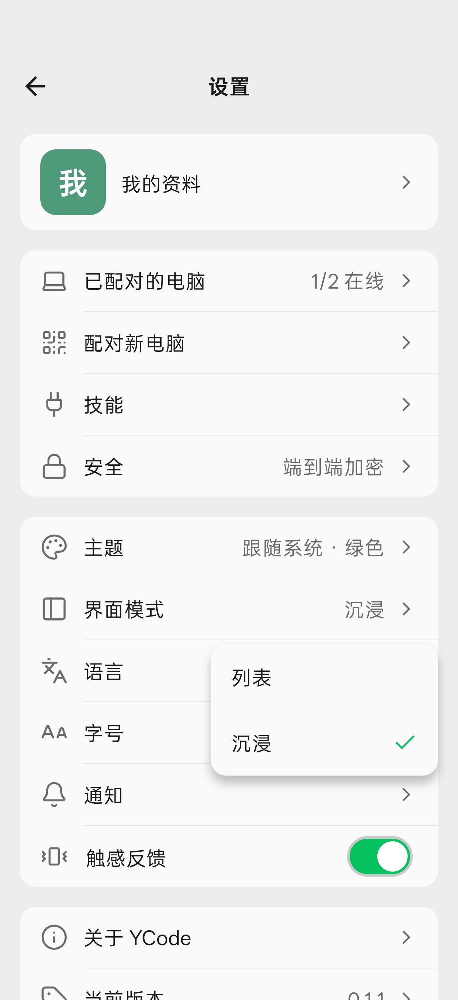
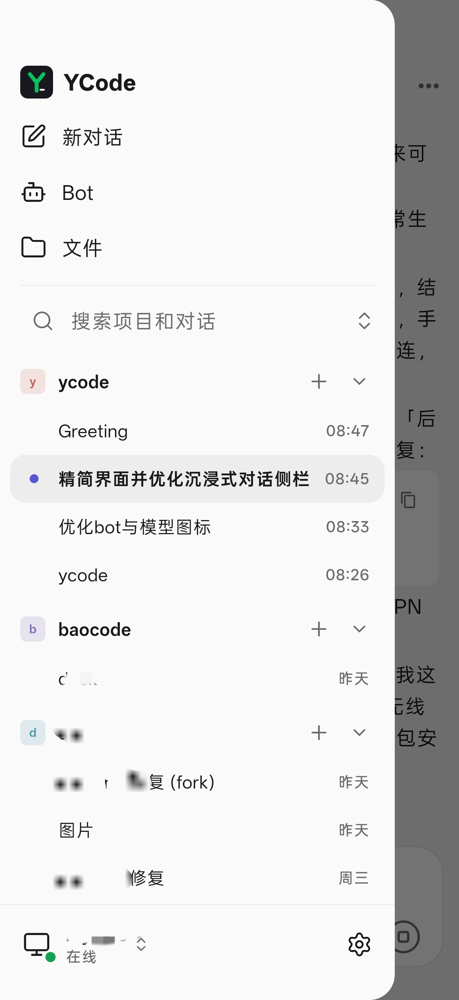

# YCode

**English** · [简体中文](README_CN.md)

[Download for Android](https://github.com/shuishani/ycode/releases/latest) · [Changelog](CHANGELOG.md) · [Issues](https://github.com/shuishani/ycode/issues)

YCode is an independent, unofficial Android client for the BaoCode desktop app, maintained by shuishan and built with Flutter. It pairs with your computer over BaoCode's official link v2 protocol (iroh/QUIC, Ed25519, end-to-end encrypted), so you can follow and continue your desktop conversations from your phone.

| Home | Conversation |
| :---: | :---: |
|  |  |
| **Switching the layout** | **Focus side panel** |
|  |  |

YCode is not an official BaoCode product and is not supported by the BaoCode team. Model calls, credentials and task execution stay on the desktop. Only connect to computers you trust.

## Install and update

- **Install BaoCode on your computer first**: website <https://baocode.dev>, download <https://baocode.dev/download>. In the desktop app, open Settings → Mobile to show a QR code, then scan it with YCode to pair.
- **Install YCode**: download the APK from [GitHub Releases](https://github.com/shuishani/ycode/releases). It runs on arm64 devices with Android 7.0 or later. iOS is not supported yet.
- **Updates**: YCode checks for updates every time it opens, offers new versions in a dialog, and downloads and installs them in the app. You can also check under Settings → Current version. The first update asks you to allow YCode to install unknown apps. Updating in place keeps your pairings and data; don't uninstall to update.

## Features

- Two layouts, switched under Settings → Layout: "List" has Conversations, Bots, Files and Settings tabs; "Focus" opens straight into your last conversation, with projects and conversations in a side panel.
- Chinese and English; follows the system theme or light/dark.
- Pair by QR code, pasted link or LAN discovery; multiple computers; reconnects after drops; optionally keeps the connection in the background (experimental).
- Search, pin and archive projects and conversations, and unfold a project's conversations right on the home list; streaming messages, queued and immediate sends, images and @ files, / commands.
- Edit and resend an earlier message, optionally undoing the files the agent changed after it; a context usage ring in the composer (both need BaoCode desktop 1.9.3 or later).
- Markdown, code highlighting, math and offline Mermaid; folded tools and thinking, approvals and questions, plans, subagents.
- Switch models, modes and permissions with provider icons; quota checks need desktop support, and the official desktop shows them as unsupported.
- Add, edit and chat with Bots, with avatars and memory.
- File tree, search, preview and diffs, with keeping or undoing changes.

## Development

Requires Flutter 3.47 / Dart 3.13, JDK 21, the Android SDK/NDK and Rust 1.97.1 (pinned by `vendor/bao_iroh/rust/rust-toolchain.toml`). Only the Android project exists; there is no iOS project.

Keep the Android SDK and Flutter paths in your local `android/local.properties`, which is not committed. On Windows you can use `tool/prepare_android.ps1`, or follow the [build guide](docs/release-android.md).

```sh
flutter pub get
flutter analyze --no-pub
# Run the tests related to your change, for example:
flutter test --no-pub test/state/update_check_test.dart test/state/apk_download_test.dart test/widgets/update_check_test.dart
flutter run --dart-define=DEMO=true   # demo data, no desktop needed
```

Packaging, signing, installing and releasing are described in [docs/release-android.md](docs/release-android.md) (Chinese). `tool/fixture_desktop.dart` is a synthetic desktop for tests that never touches real repositories or models.

## Origin and license

Copyright (C) 2026 shuishan. The project as a whole is released under **GPL-3.0-only**; see [LICENSE](LICENSE).

- The protocol package `vendor/bao_link` and the files copied or adapted from BaoCode are GPL-3.0-only, copyright the BaoCode authors. `vendor/bao_iroh` and `vendor/bao_editor` keep their MIT licenses and third-party licenses.
- Icons come from Lucide, Remix Icon 4.8.0, theSVG, Simple Icons and Material Icon Theme; see [THIRD_PARTY_NOTICES.md](THIRD_PARTY_NOTICES.md) for the license texts and files. They are also listed in the app under Settings → About YCode → Open-source licenses.
- The interface was designed and built independently from screenshots of the official BaoCode mobile app, and contains none of its code or image assets. The protocol's origin, our extension and the list of files from BaoCode are in [docs/upstream-sync.md](docs/upstream-sync.md).
- The BaoCode name and logo, and the model providers' logos, belong to their respective owners.

## Contributing

Issues and pull requests are welcome; see [CONTRIBUTING.md](CONTRIBUTING.md). Please report security issues privately as described in [SECURITY.md](SECURITY.md).

Never include model credentials, pairing details, real chat logs, signing keys or signing passwords in commits or public issues.
