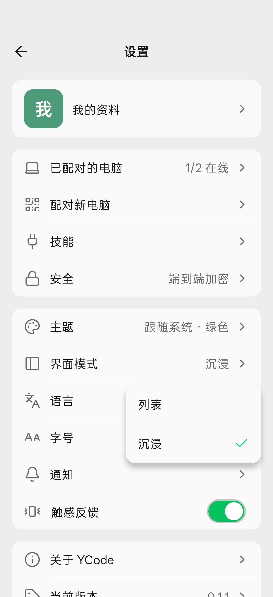
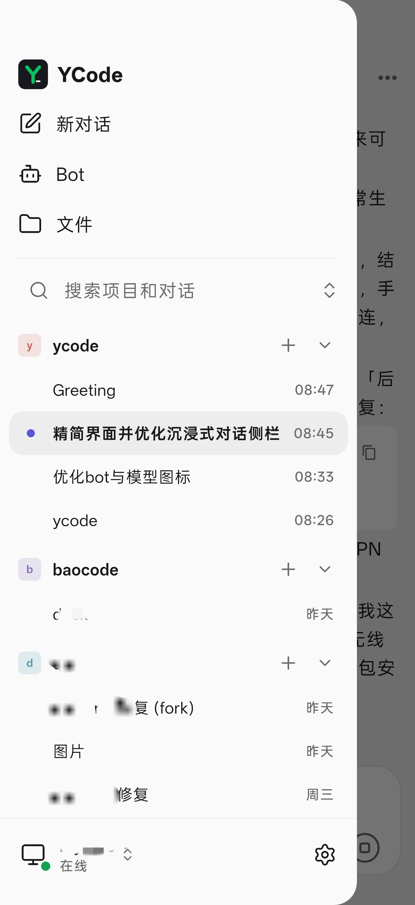

# YCode

[English](README.md) · **简体中文**

[下载 Android 安装包](https://github.com/shuishani/ycode/releases/latest) · [更新日志](CHANGELOG_CN.md) · [问题反馈](https://github.com/shuishani/ycode/issues)

YCode 是 BaoCode 电脑版的独立、非官方 Android 客户端，由 shuishan 维护，使用 Flutter 开发。通过官方 link v2 协议（iroh/QUIC、Ed25519、端到端加密）配对电脑，在手机上查看和继续电脑上的对话。

| 首页 | 对话 |
| :---: | :---: |
|  |  |
| **切换界面模式** | **沉浸模式侧边栏** |
|  |  |

本项目不属于 BaoCode 官方产品，不代表官方提供支持。电脑上的模型调用、凭据与任务执行仍由电脑端管理。请只连接自己信任的电脑。

## 安装与更新

- **先在电脑上安装 BaoCode**：官网 <https://baocode.dev>，下载 <https://baocode.dev/download>。在电脑端「设置 → 手机」显示二维码，用 YCode 扫码配对。
- **安装 YCode**：从 [GitHub Releases](https://github.com/shuishani/ycode/releases) 下载 APK，支持 Android 7.0 及以上的 arm64 设备，暂不支持 iOS。
- **更新**：打开应用时会自动检查，有新版本就弹窗，可在应用内下载安装；也可以在「设置 → 当前版本」手动检查。首次更新时需要允许 YCode「安装未知应用」。覆盖安装会保留配对和数据，不要为了更新而卸载。

## 功能

- 两种界面模式，在「设置 → 界面模式」切换：「列表」是对话、Bot、文件、设置四栏；「沉浸」打开就是上次的对话，项目和对话收在左侧边栏。
- 中英文，跟随系统或浅色/深色主题。
- 扫码、粘贴或局域网发现配对，多台电脑，断线重连；可开启后台保持电脑连接（实验性）。
- 项目和对话的搜索、置顶、归档，项目可在首页直接展开对话；流式消息、排队与立即插入、图片和 @ 文件、/ 命令。
- 编辑历史消息重发，可撤回 Agent 之后改过的文件；输入栏显示上下文用量（需电脑版 1.9.3 及以上）。
- Markdown、代码高亮、数学公式、离线 Mermaid；工具与思考折叠、审批与提问、计划、子代理。
- 切换模型、模式和权限，显示厂商图标；额度查询需要电脑端支持，官方电脑端会显示不支持。
- Bot 的添加、编辑、头像、记忆和聊天。
- 文件树、搜索、预览、改动对比，以及保留或撤回改动。

## 开发

需要 Flutter 3.47 / Dart 3.13、JDK 21、Android SDK/NDK，以及 Rust 1.97.1（由 `vendor/bao_iroh/rust/rust-toolchain.toml` 固定）。当前仅提供 Android 工程，没有 iOS 工程。

Android SDK 和 Flutter 路径放在本机的 `android/local.properties` 中，不提交。Windows 可使用 `tool/prepare_android.ps1`；也可以参考 [构建说明](docs/release-android.md) 配置。

```sh
flutter pub get
flutter analyze --no-pub
# 运行与当前改动相关的测试，例如：
flutter test --no-pub test/state/update_check_test.dart test/state/apk_download_test.dart test/widgets/update_check_test.dart
flutter run --dart-define=DEMO=true   # 演示数据，不连电脑
```

打包、签名、安装与发布见 [docs/release-android.md](docs/release-android.md)。`tool/fixture_desktop.dart` 是测试用的合成电脑，不碰真实仓库和模型。

## 来源与许可

Copyright (C) 2026 shuishan。整体项目按 **GPL-3.0-only** 发布，见 [LICENSE](LICENSE)。

- 来自 BaoCode 的协议包 `vendor/bao_link` 以及复制、改编的文件适用 GPL-3.0-only，版权归 BaoCode 作者。`vendor/bao_iroh`、`vendor/bao_editor` 保留各自的 MIT 许可及第三方许可。
- 图标来自 Lucide、Remix Icon 4.8.0、theSVG、Simple Icons 和 Material Icon Theme，许可全文与对应文件见 [THIRD_PARTY_NOTICES.md](THIRD_PARTY_NOTICES.md)。应用内「设置 → 关于 YCode → 开源许可」也会列出。
- 界面参考官方 BaoCode 手机 App 的截图自行设计与实现，不包含官方 App 的代码或图片素材。协议来源、扩展和来自 BaoCode 的文件清单见 [docs/upstream-sync.md](docs/upstream-sync.md)。
- BaoCode 名称与标识、各模型服务商的标志均归各自权利人所有。

## 参与贡献

欢迎提交 Issue 和 Pull Request，见 [CONTRIBUTING.md](CONTRIBUTING.md)。安全问题请按 [SECURITY.md](SECURITY.md) 私下报告。

请勿提交或通过公开问题附带模型凭据、配对信息、真实聊天记录、签名密钥和签名口令。
